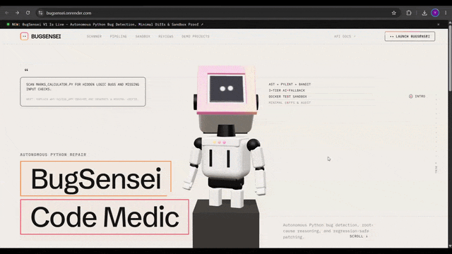
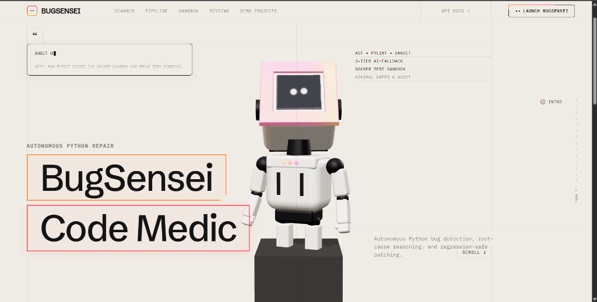
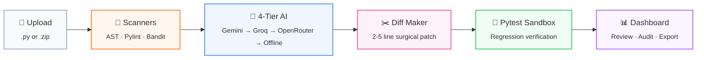

<div align="center">

  
  
  #  BugSensei
  ### **Autonomous Python Bug Detection, Minimal Diffs & Regression-Safe Patching**

  <p align="center">
    <b>A self-healing code medic that audits Python codebases, explains root causes and trigger inputs,<br/>generates surgical unified diffs, and proves zero regressions inside an isolated pytest sandbox.</b>
  </p>

  <!-- Highlighted Live Deployment Banner -->
  <p align="center">
    <a href="https://bugsensei.onrender.com" target="_blank">
      
    </a>
  </p>

  <p align="center">
    🔗 <b>Live Website:</b> <a href="https://bugsensei.onrender.com" target="_blank"><b>https://bugsensei.onrender.com</b></a> &nbsp;•&nbsp; 📊 <b>Live Dashboard:</b> <a href="https://bugsensei.onrender.com/dashboard" target="_blank"><b>bugsensei.onrender.com/dashboard</b></a>
  </p>

  <p align="center">
    <a href="#-quick-start"></a>
    <a href="#-architecture"></a>
    <a href="#-tech-stack"></a>
    <a href="#-security--safety"></a>
    <a href="LICENSE"></a>
  </p>

  <p align="center">
    <a href="https://bugsensei.onrender.com">🌐 <b>Live Demo</b></a> •
    <a href="#-preview">📸 Preview</a> •
    <a href="#-why-bugsensei">💡 Why BugSensei</a> •
    <a href="#-key-features">✨ Features</a> •
    <a href="#-architecture">🏗️ Architecture</a> •
    <a href="#-demo-projects">🧪 Demos</a> •
    <a href="#-quick-start">⚡ Quick Start</a> •
    <a href="#-cloud-deployment">🚀 Deploy</a> •
    <a href="#-api-reference">📜 API</a>
  </p>

  <!-- Demo GIF Walkthrough -->
  <br/>
  <p align="center">
    
    <br/>
    <sub><i>Scan → Explain → Patch → Verify, end to end in seconds.</i></sub>
  </p>

</div>

<br/>

---

## 📸 Preview

<table>
  <tr>
    <td width="50%" align="center">
      <b>🎨 3D Editorial Landing Page</b><br/>
      <sub>Three.js companion robot with eye tracking, live backend health, and capabilities carousel.</sub><br/><br/>
      <a href="https://bugsensei.onrender.com" target="_blank">
        
      </a>
    </td>
    <td width="50%" align="center">
      <b>📊 Scanning & Repair Dashboard (v2.4)</b><br/>
      <sub>Upload, metrics, LLM reasoning, before/after proofs, patch decisions, and one-click export.</sub><br/><br/>
      <a href="https://bugsensei.onrender.com/dashboard" target="_blank">
        
      </a>
    </td>
  </tr>
</table>

<details>
  <summary><b>☁️ Click to view the live cloud deployment preview on Render</b></summary>
  <br/>
  <p align="center">
    <a href="https://bugsensei.onrender.com" target="_blank">
      
    </a>
  </p>
</details>

---

## 💡 Why BugSensei?

| Capability | 🔧 Traditional Linters | 🤖 Raw LLM Chat |  **BugSensei** |
|:---|:---:|:---:|:---:|
| **Explains the bug** | ❌ Line numbers & rule codes only | ⚠️ General / verbose | ✅ **Root cause + exact trigger input** |
| **Provides a patch** | ❌ None | ⚠️ Rewrites entire files | ✅ **Minimal unified diff (2–5 lines)** |
| **Verifies the fix** | ❌ None | ❌ Never executes code | ✅ **Before / after pytest in sandbox** |
| **Works offline** | ✅ Yes | ❌ Breaks without API | ✅ **Deterministic fallback templates** |
| **Human control** | ➖ N/A | ➖ Blind apply | ✅ **Accept / Reject / Needs Review** |

---

## ✨ Key Features

<table>
  <tr>
    <td width="50%" valign="top">
      <b>🛡️ Hybrid Multi-Engine Detection</b>
      <ul>
        <li><b>AST Checker:</b> Unhandled <code>ZeroDivisionError</code>, mutable defaults (<code>def f(a=[])</code>), empty-container indexing, and swallowed exceptions.</li>
        <li><b>Pylint:</b> Undefined variables, syntax violations, unused imports, and code smells.</li>
        <li><b>Bandit:</b> Hardcoded credentials (<code>B105</code>), weak MD5/SHA1 hashes (<code>B324</code>), and shell injection risks.</li>
      </ul>
    </td>
    <td width="50%" valign="top">
      <b>🧠 4-Tier AI Fallback</b>
      <p align="center" style="font-family: monospace; font-size: 12px; background: #f6f8fa; padding: 8px; border-radius: 6px;">
        Gemini 2.5 Flash<br/>
        ↓ <i>timeout / quota</i><br/>
        Groq · Llama 3.3 70B<br/>
        ↓ <i>timeout / quota</i><br/>
        OpenRouter · DeepSeek V3<br/>
        ↓ <i>offline / no keys</i><br/>
        <b>Deterministic Templates</b>
      </p>
      <sub><i>BugSensei never stops working, even with no internet or exhausted API limits.</i></sub>
    </td>
  </tr>
  <tr>
    <td width="50%" valign="top">
      <b>🎯 Root Cause & Trigger Inputs</b><br/>
      Every report includes a clear root-cause diagnosis and the exact inputs that trigger failure (e.g., <code>scores = []</code>, <code>b = 0</code>).<br/><br/>
      <b>✂️ Minimal Unified Diffs</b><br/>
      Outputs standard <code>--- a/app.py</code> / <code>+++ b/app.py</code> patches. Whole files are never rewritten.
    </td>
    <td width="50%" valign="top">
      <b>🧪 Isolated Pytest Sandbox</b><br/>
      Zero-network, resource-capped runs (Docker or direct sandbox) verifying regression safety:<br/>
      <code>Tests (Before) → Apply Patch → Tests (After)</code><br/><br/>
      <b>👨‍💻 Full Developer Control</b><br/>
      Accept / Reject / Needs Review controls, JSON audit logs (<code>reports/change_history.json</code>), and direct export of repaired files.
    </td>
  </tr>
</table>

> ⚡ **Pre-loaded interactive demos** allow evaluators to inspect source code and execute scans in one click.

---

## 🏗️ Architecture



---

## 🧪 Demo Projects

Four intentionally flawed applications are pre-bundled in [`demo_projects/`](demo_projects/) to test every layer of the engine:

| Project | Bugs | Detected By | What BugSensei Proves |
|---|---|---|---|
| **📝 `marks_calculator`** | Missing score bounds check, `ZeroDivisionError` on `[]` | AST + LLM | Adds guard `if not marks: return 0.0`; sandbox passes 4/4 pytest suite. |
| **➗ `divide_app`** | Division by zero, mutable default `cache={}` | AST + Pylint | Fixes `cache=None` initialization and adds zero-divisor check; function signatures unchanged. |
| **🔐 `user_auth`** | Hardcoded password (`B105`), weak MD5 hash (`B324`) | Bandit | Upgrades to salted SHA-256, extracts credentials to environment configuration. |
| **📦 `inventory_tracker`** | Bare `except:` swallowing `KeyError`, unvalidated discount | AST + Pylint + Pytest | Implements explicit exception handling and clamps discount rates to `0 <= rate <= 1.0`. |

---

## ⚡ Quick Start

### Prerequisites
- Python 3.10, 3.11, or 3.12
- Node.js 18+ *(only to rebuild the frontend; a prebuilt bundle is included in `frontend/dashboard/dist`)*
- Docker *(optional; automatically falls back to isolated local pytest if Docker is not installed)*

---

### Option 1: Run Locally (Recommended)

```bash
# 1. Clone repository
git clone https://github.com/Yashwanth-MS/bugsensei.git
cd bugsensei

# 2. (Optional) Set API keys; works fully offline with fallback templates without them
cp .env.example .env

# 3. Install dependencies and start server
pip install -r requirements.txt
cd backend
python -m uvicorn main:app --host 0.0.0.0 --port 8000 --reload
```

| Page | URL |
|---|---|
| **🎨 3D Landing Page** | [http://localhost:8000/](http://localhost:8000/) |
| **📊 Scanner Dashboard** | [http://localhost:8000/dashboard](http://localhost:8000/dashboard) |
| **📘 Interactive API Docs** | [http://localhost:8000/docs](http://localhost:8000/docs) |

---

### Option 2: Docker Compose

```bash
docker-compose up --build
```
Open [http://localhost:8000](http://localhost:8000).

---

## 🚀 Cloud Deployment

> 🌐 **Live Cloud Deployment**: BugSensei is running live on Render: **[https://bugsensei.onrender.com](https://bugsensei.onrender.com)**.

BugSensei is engineered as a **single-service full-stack web application**: FastAPI serves the Three.js landing page at `/`, the React + Vite dashboard at `/dashboard`, static assets, and all scan endpoints on one port. It is production-ready for Render, Railway, or Google Cloud Run.

### Deploy on Render in 2 minutes:
1. Push your repository to GitHub.
2. In the [Render Dashboard](https://dashboard.render.com/), create a new **Web Service** and connect your repo.
3. Configure:
   * **Runtime:** `Python`
   * **Build Command:** `pip install -r requirements.txt`
   * **Start Command:** `python -m uvicorn backend.main:app --host 0.0.0.0 --port $PORT`
4. Add environment variables *(optional)*:
   * `GEMINI_API_KEY`: Google AI Studio API key
   * `GROQ_API_KEY`: Groq Cloud API key
   * `OPENROUTER_API_KEY`: OpenRouter API key
   * `SANDBOX_ENABLED`: `false` *(recommended for cloud containers without Docker-in-Docker)*

---

## 📜 API Reference

Interactive Swagger documentation is auto-generated at `/docs`.

| Method | Endpoint | Description | Payload |
|---|---|---|---|
| `GET` | `/` | 3D Landing Page | None |
| `GET` | `/dashboard` | React scanning dashboard | None |
| `GET` | `/health` | Engine status & diagnostic telemetry | None |
| `POST` | `/scan` | Scan a Python file or `.zip` project | `multipart/form-data` (`file`) |
| `POST` | `/scan/code` | Scan a raw code string | `{ "code": "...", "filename": "app.py", "test_code": "..." }` |
| `POST` | `/decision/{bug_id}` | Log a human decision | `{ "action": "ACCEPTED" \| "REJECTED", "note": "..." }` |
| `GET` | `/history` | Retrieve audit log history | None |

#### Example cURL:
```bash
curl -X POST http://localhost:8000/scan/code \
  -H "Content-Type: application/json" \
  -d '{"code": "def avg(m):\n    return sum(m)/len(m)", "filename": "app.py"}'
```

---

## 🧰 Tech Stack

| Layer | Technologies |
|---|---|
| **Backend** | Python 3.11, FastAPI, Uvicorn, Pydantic |
| **Analysis** | Python `ast`, Pylint, Bandit Security Scanner |
| **AI Fallback** | Gemini 2.5 Flash, Groq (Llama 3.3 70B), OpenRouter (DeepSeek V3) |
| **Verification** | Pytest, Docker Sandbox (`--network=none`, memory/CPU caps) |
| **Frontend** | React 18, Vite, Tailwind CSS, Three.js 0.160.0 |

---

## 🔒 Security & Safety

| Safeguard | Details |
|---|---|
| 🧱 **Isolated Execution** | Tests execute with `--network=none`, 256MB RAM, 0.5 CPU, and a 10s strict timeout. |
| ✂️ **Non-Destructive Patching** | Minimal unified diffs only; original files remain backed up. |
| 👤 **Human-in-the-Loop** | Every patch requires an explicit developer decision (`Accept` / `Reject`) before it persists. |

---

<details>
  <summary><b>📂 Click to view Project Structure Tree</b></summary>
  <br/>

```text
BUGSENSEI/
├── assets/                     # Media, screenshots & demo graphics
│   ├── demo.gif                # Live animated walkthrough (< 1 MB)
│   ├── landing_hero.png        # 3D landing page hero screenshot
│   ├── dashboard_preview.jpg   # React dashboard v2.4 screenshot
│   ├── render_deployment.jpg   # Render cloud deployment preview
│   ├── logo.jpg                # Green Vortex brand icon
│   └── logo.svg                # BugSensei vector logo
├── backend/                    # FastAPI core service & analysis engines
│   ├── main.py                 # REST API router & static SPA server
│   ├── requirements.txt        # Backend dependencies
│   ├── llm/
│   │   └── provider.py         # 3-tier fallback (Gemini → Groq → OpenRouter)
│   ├── patcher/
│   │   └── diff_maker.py       # Minimal unified diff engine
│   ├── reports/
│   │   └── change_history.json # JSON audit trail of patch decisions
│   ├── scanner/
│   │   ├── ast_checker.py      # Abstract Syntax Tree logic scanner
│   │   ├── lint_runner.py      # Pylint & Bandit subprocess runners
│   │   └── llm_scanner.py      # LLM prompt orchestration & fallback logic
│   └── tester/
│       ├── test_generator.py   # Automated pytest assertion generator
│       └── test_runner.py      # Sandbox execution & regression counter
├── demo_projects/              # Evaluator test suites with real bugs
│   ├── marks_calculator/       # Logic bugs & zero-division edge cases
│   ├── divide_app/             # Mutable default arguments & zero division
│   ├── user_auth/              # Hardcoded credentials & weak MD5 hashes
│   └── inventory_tracker/      # Silent failure suppression & bounds checks
├── frontend/                   # UI applications
│   ├── landing/
│   │   └── index.html          # Single-file Three.js 3D landing page
│   └── dashboard/              # React 18 + Vite + Tailwind dashboard
│       ├── src/                # Component architecture & state machines
│       └── dist/               # Prebuilt production distribution bundle
├── sandbox/                    # Docker container configuration
│   └── Dockerfile              # Zero-network secured runner
├── docker-compose.yml          # Container orchestration
├── requirements.txt            # Root pip dependencies
└── README.md                   # Project documentation
```

</details>

---

<div align="center">

  ⭐ **If BugSensei helped you, consider giving it a star on GitHub!**

  <sub>Crafted with passion for <b>INNOVEDGE Hackathon 2026</b> by <b>Green Vortex AI Innovation</b>.</sub>
  <br/>
  <sub>Autonomous Code Medic · Python AST · Pylint · Bandit · Pytest · Three.js</sub>

</div>
