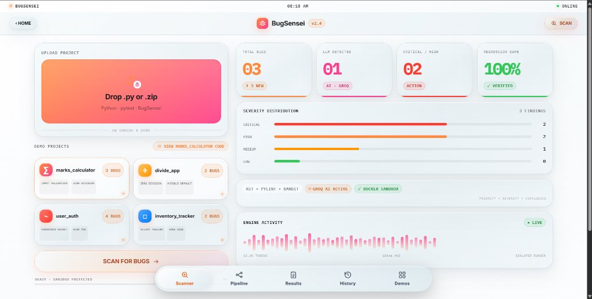
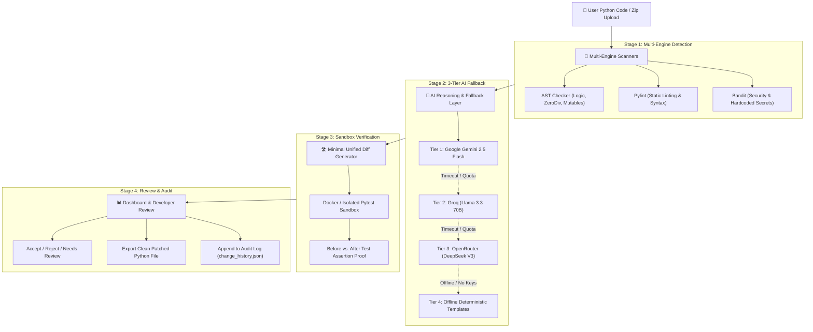

<div align="center">

  

  # 🩺 BugSensei
  ### **Autonomous Python Bug Detection, Minimal Diffs & Regression-Safe Patching**

  <p align="center">
    <b>A self-healing code medic that audits Python codebases, reasons about root causes and trigger inputs, generates surgical unified diffs, and proves zero regressions inside an isolated pytest sandbox.</b>
  </p>

  <p align="center">
    <a href="#-key-features"></a>
    <a href="#-quick-start"></a>
    <a href="#-architecture"></a>
    <a href="#-frontend--dashboard"></a>
    <a href="#-isolated-sandbox"></a>
    <a href="LICENSE"></a>
  </p>

  <p align="center">
    <a href="#-key-features">✨ Features</a> •
    <a href="#-live-walkthrough--preview">📸 Screenshots</a> •
    <a href="#-quick-start">⚡ Quick Start</a> •
    <a href="#-architecture">🏗️ Architecture</a> •
    <a href="#-demo-projects">🧪 Demo Projects</a> •
    <a href="#-deployment">🚀 Deployment</a> •
    <a href="#-api-reference">📜 API Docs</a>
  </p>

</div>

---

## 🌟 Live Walkthrough & Preview

### 1. High-Craft 3D Editorial Landing Page
> Powered by Three.js with an interactive procedural 3D companion robot, eye tracking, dynamic prompt auto-typing box, live backend health monitoring, and a smooth-scrolling capabilities carousel.

<p align="center">
  
</p>

---

### 2. Autonomous Bug Scanning & Repair Dashboard (v2.4)
> Unified developer command center featuring real-time upload, AST/lint/security distribution metrics, LLM reasoning telemetry, before-and-after regression proofs, interactive patch decision controls, and one-click code export.

<p align="center">
  
</p>

---

### 3. Demo Walkthrough
<!-- Drop your screen recording or animated demo as assets/demo.gif to display here -->
<p align="center">
  
  <br />
  <sub><i>Live Cloud Deployment on Render: Autonomous scan pipeline with real-time feedback and sandbox verification.</i></sub>
</p>

---

## 💡 The Problem & The BugSensei Solution

| The Traditional Way | The Raw LLM Way | The BugSensei Way 🩺 |
|---|---|---|
| **Static Linters (Pylint / Flake8)** flag line numbers and obscure rule codes, but don't explain the bug or provide a patch. | **Chatting with ChatGPT / Copilot** rewrites entire files, hallucinations introduce new logic errors, and no test proofs are given. | **Autonomous 5-Stage Pipeline**: Combines deterministic static analysis with multi-tier LLM reasoning to pinpoint root causes and exact trigger inputs. |
| **Manual Debugging** requires hours of reading tracebacks and writing test assertions from scratch. | **Unchecked Code Ingestion** risks silent regressions and breaks peripheral dependencies. | **Surgical Minimal Diffs**: Only changes the exact offending lines (2–5 lines), leaving surrounding architecture untouched. |
| **No Safety Guarantee**: Patches are applied blindly without verification. | **No Execution Sandbox**: Code is never executed to check if tests pass. | **Isolated Sandbox Proof**: Executes pytest in an isolated sandbox with zero network access and before/after verification. |

---

## ✨ Key Features

- **🛡️ Hybrid Multi-Engine Detection**:
  - **AST Logic Checker**: Scans Python Abstract Syntax Trees for unhandled `ZeroDivisionError`, mutable default arguments (`def func(a=[])`), dangerous empty container indexing, and unhandled exceptions.
  - **Pylint Analysis**: Catches undefined variables, syntax violations, unused imports, and code smells.
  - **Bandit Security Scanner**: Discovers hardcoded credentials (`B105`), weak hashing algorithms like MD5/SHA1 (`B324`), and shell injection risks.
  - **3-Tier AI Fallback**:
    $$\text{Gemini 2.5 Flash} \longrightarrow \text{Groq (Llama 3.3 70B)} \longrightarrow \text{OpenRouter (DeepSeek V3)} \longrightarrow \text{Offline Deterministic Templates}$$
    *Guarantees BugSensei never crashes or stops functioning, even without internet or when API quotas are exceeded.*
- **🎯 Root Cause & Reproducible Trigger Inputs**:
  - Every detected bug report includes a human-readable explanation and the exact test inputs that trigger the failure (e.g. `scores = []` or `b = 0`).
- **✂️ Minimal Unified Diffs**:
  - Outputs standard unified diffs (`--- a/app.py` `+++ b/app.py`). Never rewrites whole files.
- **🧪 Isolated Pytest Sandbox**:
  - Executes unit tests in a zero-network, memory-capped runner (via Docker or local isolated execution) to prove regression safety:
  $$\text{Tests Passed (Before)} \longrightarrow \text{Apply Surgical Patch} \longrightarrow \text{Tests Passed (After)}$$
- **👨‍💻 Full Developer Control**:
  - Review patches with **Accept**, **Reject**, or **Needs Review** buttons.
  - Audit trail persists in structured JSON format (`reports/change_history.json`).
  - **Export Fixed File**: Download or inspect the finalized repaired source code directly.
- **⚡ Pre-Loaded Interactive Demos**:
  - Built-in testbeds with code inspection modals so judges and evaluators can preview source code before initiating a scan.

---

## 🏗️ Architecture & Pipeline



---

## 🧪 Demo Projects (Preloaded for Evaluators)

BugSensei comes pre-bundled with 4 intentionally flawed applications in [`demo_projects/`](file:///c:/Users/YASWANTH%20M%20S/Downloads/BUGSENSEI/demo_projects) to test every layer of the detection engine:

| Demo Project | Target Bugs | Detection Method | What BugSensei Proves |
|---|---|---|---|
| **`marks_calculator`** | Missing score bounds check, `ZeroDivisionError` on empty list `[]` | AST Logic Checker + LLM | Explains empty list division, crafts patch with guard `if not marks: return 0.0`, sandbox passes 4/4 pytest suite. |
| **`divide_app`** | Unhandled division by zero + dangerous mutable default argument `cache={}` | AST Checker + Pylint | Fixes `cache=None` initialization and adds zero-divisor check without changing function signatures. |
| **`user_auth`** | Hardcoded credential string (`B105`) + insecure MD5 password hash (`B324`) | Bandit Security Scanner | Upgrades hashing to SHA-256 with salt, extracts secrets to environment configuration. |
| **`inventory_tracker`** | Silent `KeyError` swallowing with broad `except:` + unvalidated discount values | AST + Pylint + Pytest | Replaces bare exceptions with explicit handling and clamps discount rates to `0 <= rate <= 1.0`. |

---

## ⚡ Quick Start

### Prerequisites
- Python 3.10, 3.11, or 3.12
- Node.js 18+ (only if rebuilding frontend; prebuilt bundle is included in `frontend/dashboard/dist`)
- Docker *(optional; isolated direct pytest runs automatically if Docker is unavailable)*

---

### Method 1: Local One-Command Run (Recommended)

1. **Clone the repository:**
   ```bash
   git clone https://github.com/your-username/BUGSENSEI.git
   cd BUGSENSEI
   ```

2. **Configure Environment Variables (Optional):**
   ```bash
   cp .env.example .env
   ```
   *(BugSensei runs fully offline with deterministic fallbacks if no API keys are provided).*

3. **Install Dependencies & Launch:**
   ```bash
   pip install -r requirements.txt
   cd backend
   python -m uvicorn main:app --host 0.0.0.0 --port 8000 --reload
   ```

4. **Open in Browser:**
   - **3D Landing Page:** [http://localhost:8000/](http://localhost:8000/)
   - **Bug Scanner Dashboard:** [http://localhost:8000/dashboard](http://localhost:8000/dashboard)
   - **Interactive API Documentation:** [http://localhost:8000/docs](http://localhost:8000/docs)

---

### Method 2: Docker Compose

Run the entire application (FastAPI + Dockerized Pytest Sandbox):

```bash
docker-compose up --build
```
Access the application at [http://localhost:8000](http://localhost:8000).

---

## 🚀 Cloud Deployment (Render / Railway / Cloud Run)

BugSensei is engineered as a **single-service full-stack web application**:
FastAPI serves the 3D Three.js landing page on `/`, hosts the production React + Vite dashboard at `/dashboard`, mounts static assets, and powers the scanning endpoints on the same port.

### Deploying on Render in 2 Minutes:
1. Push your repository to GitHub.
2. In [Render Dashboard](https://dashboard.render.com/), create a new **Web Service**.
3. Connect your repository and configure:
   - **Runtime:** `Python`
   - **Build Command:** `pip install -r requirements.txt`
   - **Start Command:** `python -m uvicorn backend.main:app --host 0.0.0.0 --port $PORT`
4. Set optional Environment Variables:
   - `GEMINI_API_KEY`: *(Your Google AI Studio Key)*
   - `GROQ_API_KEY`: *(Your Groq Cloud Key)*
   - `OPENROUTER_API_KEY`: *(Your OpenRouter Key)*
   - `SANDBOX_ENABLED`: `false` *(recommended for cloud containers without Docker-in-Docker)*

---

## 📜 API Reference

FastAPI automatically generates interactive Swagger documentation at `/docs`.

| Method | Endpoint | Description | Payload / Params |
|---|---|---|---|
| `GET` | `/` | Serves the 3D Three.js Landing Page | None |
| `GET` | `/dashboard` | Serves the React Bug Scanning Dashboard | None |
| `GET` | `/health` | Returns engine status & diagnostic telemetry | None |
| `POST` | `/scan` | Scans a Python file or `.zip` project archive | `multipart/form-data` (`file`) |
| `POST` | `/scan/code` | Scans raw Python code string directly | JSON `{ "code": "...", "filename": "app.py", "test_code": "..." }` |
| `POST` | `/decision/{bug_id}` | Logs human-in-the-loop decision | JSON `{ "action": "ACCEPTED" \| "REJECTED", "note": "..." }` |
| `GET` | `/history` | Retrieves audit log history | None |

---

## 📂 Project Structure

```text
BUGSENSEI/
├── assets/                     # README media, screenshots & demo graphics
│   ├── landing_hero.png        # 3D landing page hero screenshot
│   ├── dashboard_preview.jpg   # React dashboard v2.4 screenshot
│   ├── render_deployment.jpg   # Render live deployment preview
│   └── logo.jpg                # Green Vortex brand icon
├── backend/                    # FastAPI core service & analysis engines
│   ├── main.py                 # REST API router & static SPA server
│   ├── requirements.txt        # Backend Python dependencies
│   ├── llm/
│   │   └── provider.py         # 3-tier fallback (Gemini → Groq → OpenRouter)
│   ├── patcher/
│   │   └── diff_maker.py       # Minimal unified diff engine
│   ├── reports/
│   │   └── change_history.json # JSON audit trail of patch decisions
│   ├── scanner/
│   │   ├── ast_checker.py      # Abstract Syntax Tree logic scanner
│   │   ├── lint_runner.py      # Pylint & Bandit subprocess runners
│   │   └── llm_scanner.py      # LLM prompt orchestration & fallback logic
│   └── tester/
│       ├── test_generator.py   # Automated pytest assertion generator
│       └── test_runner.py      # Sandbox execution & regression counter
├── demo_projects/              # Evaluator test suites with real bugs
│   ├── marks_calculator/       # Logic bugs & zero-division edge cases
│   ├── divide_app/             # Mutable default arguments & zero division
│   ├── user_auth/              # Hardcoded credentials & weak MD5 hashes
│   └── inventory_tracker/      # Silent failure suppression & bounds checks
├── frontend/                   # UI applications
│   ├── landing/
│   │   └── index.html          # Single-file Three.js 3D landing page
│   └── dashboard/              # React 18 + Vite + Tailwind dashboard
│       ├── src/                # Component architecture & state machines
│       └── dist/               # Prebuilt production distribution bundle
├── sandbox/                    # Docker container configuration
│   └── Dockerfile              # Zero-network secured runner
├── docker-compose.yml          # Container orchestration
├── requirements.txt            # Root pip dependencies
└── README.md                   # Project documentation
```

---

## 🔒 Security & Accidental Data Loss Prevention

- **Isolated Execution**: BugSensei runs unit tests with `--network=none`, CPU/RAM bounds (`256MB`, `0.5 CPU`), and a strict 10s execution timeout.
- **Surgical Non-Destructive Patching**: Source files are patched via minimal unified diffs (`patch`), never rewritten from scratch. Original files remain backed up.
- **Human-in-the-Loop Audit**: Every applied patch requires explicit developer review (`Accept` / `Reject`) before persisting into production files.

---

<div align="center">

  <sub>Crafted with passion for <b>INNOVEDGE Hackathon 2026</b> by <b>Green Vortex AI Innovation</b>.</sub>
  <br />
  <sub>Autonomous Code Medic · Python AST · Pylint · Bandit · Pytest · Three.js</sub>

</div>
