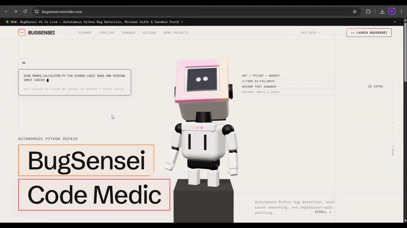
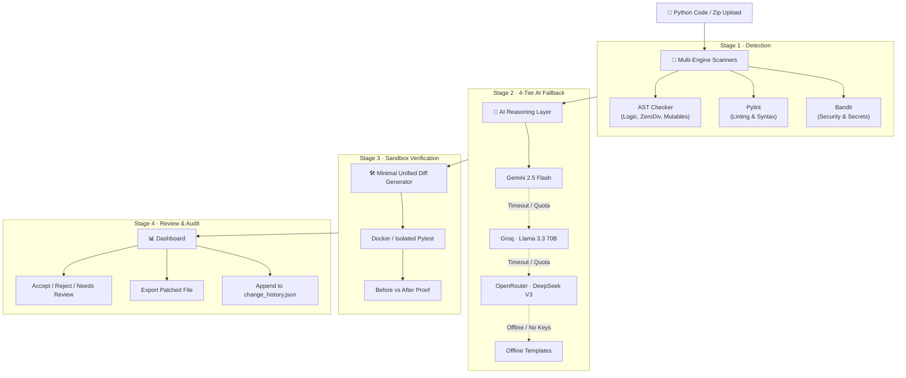

<div align="center">


#  BugSensei

### Autonomous Python Bug Detection, Minimal Diffs & Regression-Safe Patching

**A self-healing code medic that audits Python codebases, explains root causes and trigger inputs,<br/>generates surgical unified diffs, and proves zero regressions inside an isolated pytest sandbox.**

<br/>

<a href="#-quick-start"></a>
<a href="#-architecture"></a>
<a href="#-tech-stack"></a>
<a href="#-security--safety"></a>
<a href="LICENSE"></a>

<br/><br/>

[✨ Features](#-key-features) •
[📸 Preview](#-preview) •
[⚡ Quick Start](#-quick-start) •
[🏗️ Architecture](#-architecture) •
[🧪 Demo Projects](#-demo-projects) •
[🚀 Deploy](#-cloud-deployment) •
[📜 API](#-api-reference)

<br/>

<!-- Demo GIF: keep it under 5 MB (≈ 600–720px wide, 8–10 fps, 5–8 seconds) -->


<sub><i>Scan → Explain → Patch → Verify, end to end in a few seconds.</i></sub>

</div>

<br/>

---

## 📸 Preview

<table>
  <tr>
    <td width="50%" align="center">
      <b>🎨 3D Editorial Landing Page</b><br/>
      <sub>Three.js companion robot with eye tracking, live backend health, and a capabilities carousel.</sub><br/><br/>
      
    </td>
    <td width="50%" align="center">
      <b>📊 Scanning & Repair Dashboard (v2.4)</b><br/>
      <sub>Upload, metrics, LLM reasoning, before/after proofs, patch decisions, and one-click export.</sub><br/><br/>
      
    </td>
  </tr>
</table>

<details>
<summary><b>☁️ See the live cloud deployment on Render</b></summary>
<br/>
<p align="center">
  
</p>
</details>

---

## 💡 Why BugSensei?

| | 🔧 Traditional Linters | 🤖 Raw LLM Chat |  **BugSensei** |
|---|---|---|---|
| **Explains the bug** | ❌ Line numbers and rule codes only | ⚠️ Sometimes | ✅ Root cause + exact trigger input |
| **Provides a patch** | ❌ | ⚠️ Rewrites whole files | ✅ Minimal unified diff (2–5 lines) |
| **Verifies the fix** | ❌ | ❌ Never executes code | ✅ Before/after pytest in a sandbox |
| **Works offline** | ✅ | ❌ | ✅ Deterministic fallback templates |
| **Human control** | ➖ | ➖ | ✅ Accept / Reject / Needs Review |

---

## ✨ Key Features

<table>
  <tr>
    <td width="50%" valign="top">

### 🛡️ Hybrid Multi-Engine Detection
- **AST Checker**: unhandled `ZeroDivisionError`, mutable defaults (`def f(a=[])`), empty-container indexing, swallowed exceptions
- **Pylint**: undefined variables, syntax issues, unused imports, code smells
- **Bandit**: hardcoded credentials (`B105`), weak hashes MD5/SHA1 (`B324`), shell injection risks

  </td>
    <td width="50%" valign="top">

### 🧠 4-Tier AI Fallback
```text
Gemini 2.5 Flash
   ↓  timeout / quota
Groq (Llama 3.3 70B)
   ↓  timeout / quota
OpenRouter (DeepSeek V3)
   ↓  offline / no keys
Deterministic Templates
```
*BugSensei never stops working, even with no internet or exhausted API quotas.*

  </td>
  </tr>
  <tr>
    <td width="50%" valign="top">

### 🎯 Root Cause & Trigger Inputs
Every report includes a human-readable explanation and the exact inputs that break the code (e.g. `scores = []`, `b = 0`).

### ✂️ Minimal Unified Diffs
Standard `--- a/app.py` / `+++ b/app.py` diffs. Whole files are never rewritten.

  </td>
    <td width="50%" valign="top">

### 🧪 Isolated Pytest Sandbox
Zero-network, memory-capped runs (Docker or local isolation) that prove the fix:

`Tests (Before)` → `Apply Patch` → `Tests (After)`

### 👨‍💻 Full Developer Control
Accept / Reject / Needs Review, a JSON audit trail (`reports/change_history.json`), and export of the fixed file.

  </td>
  </tr>
</table>

> ⚡ **Pre-loaded interactive demos** let evaluators inspect source code before starting a scan.

---

## 🏗️ Architecture



---

## 🧪 Demo Projects

Four intentionally flawed apps ship in [`demo_projects/`](demo_projects) to exercise every layer of the engine:

| Project | Bugs | Detected By | What BugSensei Proves |
|---|---|---|---|
| 📝 **`marks_calculator`** | Missing bounds check, `ZeroDivisionError` on `[]` | AST + LLM | Adds guard `if not marks: return 0.0`; sandbox passes 4/4 tests |
| ➗ **`divide_app`** | Division by zero, mutable default `cache={}` | AST + Pylint | Switches to `cache=None` and adds a zero-divisor check, signatures unchanged |
| 🔐 **`user_auth`** | Hardcoded secret (`B105`), MD5 hashing (`B324`) | Bandit | Upgrades to salted SHA-256, moves secrets to environment config |
| 📦 **`inventory_tracker`** | Bare `except:` hiding `KeyError`, unvalidated discounts | AST + Pylint + Pytest | Explicit exception handling, clamps rates to `0 <= rate <= 1.0` |

---

## ⚡ Quick Start

**Prerequisites**

- Python 3.10, 3.11, or 3.12
- Node.js 18+ *(only to rebuild the frontend; a prebuilt bundle is in `frontend/dashboard/dist`)*
- Docker *(optional; falls back to isolated local pytest if unavailable)*

### Option 1: Run Locally (Recommended)

```bash
# 1. Clone
git clone https://github.com/your-username/BUGSENSEI.git
cd BUGSENSEI

# 2. (Optional) add API keys; works fully offline without them
cp .env.example .env

# 3. Install and launch
pip install -r requirements.txt
cd backend
python -m uvicorn main:app --host 0.0.0.0 --port 8000 --reload
```

| Page | URL |
|---|---|
| 🎨 3D Landing Page | http://localhost:8000/ |
| 📊 Scanner Dashboard | http://localhost:8000/dashboard |
| 📘 Interactive API Docs | http://localhost:8000/docs |

### Option 2: Docker Compose

```bash
docker-compose up --build
```

Then open http://localhost:8000.

---

## 🚀 Cloud Deployment

BugSensei is a **single-service full-stack app**: FastAPI serves the Three.js landing page at `/`, the React + Vite dashboard at `/dashboard`, static assets, and all scan endpoints on one port. It works on Render, Railway, or Cloud Run.

### Deploy on Render in 2 minutes

1. Push your repository to GitHub.
2. In the [Render Dashboard](https://dashboard.render.com/), create a new **Web Service** and connect the repo.
3. Configure:

   | Setting | Value |
   |---|---|
   | **Runtime** | `Python` |
   | **Build Command** | `pip install -r requirements.txt` |
   | **Start Command** | `python -m uvicorn backend.main:app --host 0.0.0.0 --port $PORT` |

4. Add optional environment variables:

   | Variable | Purpose |
   |---|---|
   | `GEMINI_API_KEY` | Google AI Studio key |
   | `GROQ_API_KEY` | Groq Cloud key |
   | `OPENROUTER_API_KEY` | OpenRouter key |
   | `SANDBOX_ENABLED` | Set to `false` on cloud hosts without Docker-in-Docker |

---

## 📜 API Reference

Interactive Swagger docs are auto-generated at `/docs`.

| Method | Endpoint | Description | Payload |
|:---:|---|---|---|
| `GET` | `/` | 3D landing page | None |
| `GET` | `/dashboard` | React scanning dashboard | None |
| `GET` | `/health` | Engine status & diagnostics | None |
| `POST` | `/scan` | Scan a Python file or `.zip` project | `multipart/form-data` (`file`) |
| `POST` | `/scan/code` | Scan a raw code string | `{ "code": "...", "filename": "app.py", "test_code": "..." }` |
| `POST` | `/decision/{bug_id}` | Log a human decision | `{ "action": "ACCEPTED" \| "REJECTED", "note": "..." }` |
| `GET` | `/history` | Retrieve audit log | None |

**Example**

```bash
curl -X POST http://localhost:8000/scan/code \
  -H "Content-Type: application/json" \
  -d '{"code": "def avg(m):\n    return sum(m)/len(m)", "filename": "app.py"}'
```

---

## 🧰 Tech Stack

| Layer | Technologies |
|---|---|
| **Backend** | Python, FastAPI, Uvicorn |
| **Analysis** | `ast`, Pylint, Bandit |
| **AI** | Gemini 2.5 Flash, Groq (Llama 3.3 70B), OpenRouter (DeepSeek V3) |
| **Verification** | Pytest, Docker (`--network=none`) |
| **Frontend** | React 18, Vite, Tailwind CSS, Three.js |

---

## 🔒 Security & Safety

| Safeguard | Details |
|---|---|
| 🧱 **Isolated Execution** | Tests run with `--network=none`, `256MB` RAM, `0.5 CPU`, and a 10s timeout |
| ✂️ **Non-Destructive Patching** | Minimal unified diffs only; originals stay backed up |
| 👤 **Human-in-the-Loop** | Every patch needs explicit `Accept` / `Reject` before it persists |

---

<details>
<summary><b>📂 Project Structure</b></summary>

```text
BUGSENSEI/
├── assets/                     # README media & screenshots
│   ├── demo.gif                # Demo walkthrough (< 5 MB)
│   ├── landing_hero.png        # 3D landing page screenshot
│   ├── dashboard_preview.jpg   # Dashboard v2.4 screenshot
│   ├── render_deployment.jpg   # Render deployment preview
│   ├── logo.jpg                # Green Vortex brand icon
│   └── logo.svg                # BugSensei app logo
├── backend/                    # FastAPI service & analysis engines
│   ├── main.py                 # REST API router & static SPA server
│   ├── requirements.txt        # Backend dependencies
│   ├── llm/
│   │   └── provider.py         # AI fallback (Gemini → Groq → OpenRouter)
│   ├── patcher/
│   │   └── diff_maker.py       # Minimal unified diff engine
│   ├── reports/
│   │   └── change_history.json # JSON audit trail
│   ├── scanner/
│   │   ├── ast_checker.py      # AST logic scanner
│   │   ├── lint_runner.py      # Pylint & Bandit runners
│   │   └── llm_scanner.py      # LLM prompt orchestration & fallback
│   └── tester/
│       ├── test_generator.py   # Automated pytest generator
│       └── test_runner.py      # Sandbox execution & regression counter
├── demo_projects/              # Evaluator test suites with real bugs
│   ├── marks_calculator/
│   ├── divide_app/
│   ├── user_auth/
│   └── inventory_tracker/
├── frontend/
│   ├── landing/index.html      # Single-file Three.js landing page
│   └── dashboard/              # React 18 + Vite + Tailwind
│       ├── src/
│       └── dist/               # Prebuilt production bundle
├── sandbox/Dockerfile          # Zero-network secured runner
├── docker-compose.yml
├── requirements.txt
└── README.md
```

</details>

---

<div align="center">

**⭐ If BugSensei helped you, consider giving it a star!**

<sub>Crafted with passion for <b>INNOVEDGE Hackathon 2026</b> by <b>Green Vortex AI Innovation</b></sub>
<br/>
<sub>Autonomous Code Medic · Python AST · Pylint · Bandit · Pytest · Three.js</sub>

</div>
